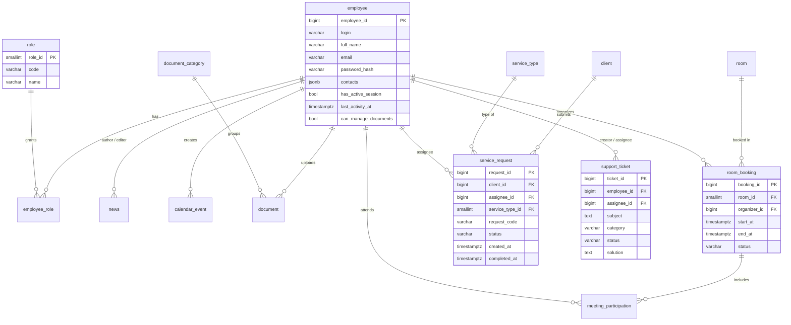

# Корпоративный портал

Внутренний портал компании и публичный сайт для клиентов: сотрудники читают новости, бронируют переговорки, ведут календарь, обрабатывают заявки клиентов и обращения в техподдержку, работают с документами. Доступ к разделам зависит от роли сотрудника.

Командный проект. **Моя часть: проектирование базы данных PostgreSQL и бэкенд на Spring Boot**, участвовал во фронтенде.

## Возможности

- **Публичный сайт:** клиент оставляет заявку на услугу и по коду заявки отслеживает ее статус без регистрации.
- **Заявки клиентов:** сотрудник берет заявку в работу, модератор или админ назначает исполнителя, сотрудник закрывает.
- **Техподдержка:** обращения сотрудников с категориями, назначением исполнителя, комментариями с историей и решением.
- **Переговорки:** бронирование комнат по времени с участниками встречи.
- **Календарь** событий компании.
- **Новости:** читают все сотрудники, публикуют и редактируют админ и модератор (сохраняется, кто и когда редактировал).
- **Документы:** загрузка и скачивание файлов по категориям, право на управление документами выдается отдельно.
- **Сотрудники (админ):** создание, роли, сброс пароля.
- **Безопасность:** вход по логину и паролю (BCrypt), JWT без серверных сессий, проверка ролей на каждом эндпоинте. Неактивная сессия завершается через 5 минут: фронтенд спрашивает «вы еще здесь?», а фоновая задача на бэкенде гасит забытые сессии.

## Роли

| Роль | Что может |
|---|---|
| `EMPLOYEE` | новости, календарь, переговорки, техподдержка; берет и закрывает заявки клиентов |
| `MODERATOR` | все, что сотрудник, плюс назначение и изменение заявок, публикация новостей |
| `ADMIN` | все, что модератор, плюс управление сотрудниками и их ролями |

## Стек

- **Бэкенд:** Java 17, Spring Boot 3.3, Spring Web, Spring Data JPA (Hibernate), Spring Security, JWT (jjwt), Bean Validation, Lombok, Maven
- **База данных:** PostgreSQL (схема `mm`, `jsonb` для контактов)
- **Фронтенд:** React 19, React Router 7

## Схема базы данных



## Структура

```text
back/   Spring Boot API (порт 9090)
  config/      безопасность, CORS, расписание фоновых задач
  security/    выпуск и проверка JWT
  Controller/  REST-эндпоинты /api/...
  service/     бизнес-логика, очистка неактивных сессий
  Repository/  Spring Data JPA
  Entity/      сущности JPA
  api/dto/     DTO запросов и ответов
front/  React-приложение (порт 3000)
```

## Запуск

Нужны Java 17+, Maven (или `mvnw` из проекта), Node.js 18+ и PostgreSQL 14+.

**1. База данных.** Создайте базу `corporate_portal`, пользователя и схему `mm`, затем таблицы из `db/schema.sql`:

```bash
psql -U postgres -c "CREATE DATABASE corporate_portal"
psql -U postgres -d corporate_portal -f db/schema.sql
```

**2. Настройки бэкенда.** Секреты не хранятся в репозитории. Скопируйте `back/.env.example` в `back/.env` и заполните:

```dotenv
DB_PASSWORD=пароль_пользователя_базы
JWT_SECRET=случайная_строка_от_32_символов
```

`JWT_SECRET` можно сгенерировать командой `openssl rand -base64 48`. Остальные параметры (адрес базы, пользователь, папка документов) тоже переопределяются переменными окружения, см. `back/src/main/resources/application.properties`.

**3. Бэкенд:**

```bash
cd back
./mvnw spring-boot:run
```

**4. Фронтенд:**

```bash
cd front
npm install
npm start
```

Портал откроется на http://localhost:3000.

## Лицензия

MIT, см. [LICENSE](LICENSE).
